  <picture><source media="(prefers-color-scheme: dark)" srcset="assets/hero-dark.svg"></picture>

  <picture><source media="(prefers-color-scheme: dark)" srcset="assets/about-dark.svg"></picture>

  <picture><source media="(prefers-color-scheme: dark)" srcset="assets/stack-dark.svg"></picture>

  <picture><source media="(prefers-color-scheme: dark)" srcset="assets/stats-dark.svg"></picture>

  <picture><source media="(prefers-color-scheme: dark)" srcset="assets/streak-dark.svg"></picture>

  <a href="https://github.com/OmHackz" title="GitHub"><picture><source media="(prefers-color-scheme: dark)" srcset="assets/button-3-dark.svg"></picture></a> &nbsp; <a href="https://x.com/OmHackz" title="X"><picture><source media="(prefers-color-scheme: dark)" srcset="assets/button-4-dark.svg"></picture></a> &nbsp; <a href="https://www.youtube.com/@OmHackz" title="YouTube"><picture><source media="(prefers-color-scheme: dark)" srcset="assets/button-5-dark.svg"></picture></a> &nbsp; <a href="https://discord.gg/omhackz" title="Discord"><picture><source media="(prefers-color-scheme: dark)" srcset="assets/button-6-dark.svg"></picture></a>

  <a href="https://modrinth.com/user/OmHackz" title="Modrinth"><picture><source media="(prefers-color-scheme: dark)" srcset="assets/button-7-dark.svg"></picture></a> &nbsp; <a href="https://www.curseforge.com/members/omhackz/" title="CurseForge"><picture><source media="(prefers-color-scheme: dark)" srcset="assets/button-8-dark.svg"></picture></a> &nbsp; <a href="https://www.roblox.com/users/7908475131/profile" title="Roblox (@OmHackc)"><picture><source media="(prefers-color-scheme: dark)" srcset="assets/button-9-dark.svg"></picture></a> &nbsp; <a href="https://omhackz.top/" title="omhackz.top"><picture><source media="(prefers-color-scheme: dark)" srcset="assets/button-2-dark.svg"></picture></a>

  <picture><source media="(prefers-color-scheme: dark)" srcset="assets/wave-dark.svg"></picture>

